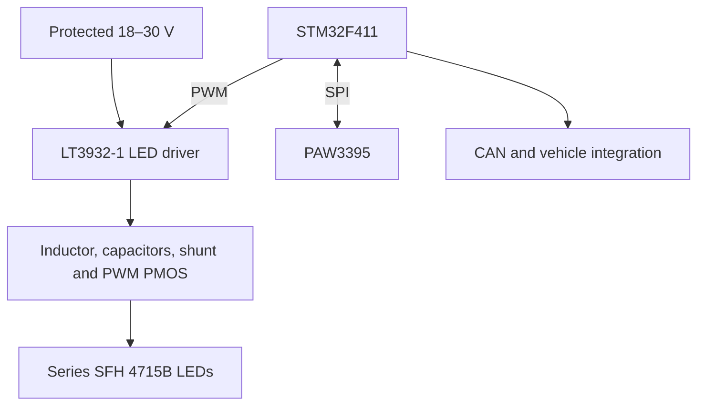

# Optical Flow Sensor (OFS)

## Purpose and current status

The OFS is intended to provide ground-relative vehicle velocity for vehicle-speed estimation and sideslip estimation on the Formula SAE car. The system uses a PixArt PAW3395 optical-navigation sensor, custom long-standoff optics, an STM32F411, and strobed 850 nm illumination.

Current status:

- PAW3395 SPI communication and signed X/Y motion data have been demonstrated on the bench.
- Typical observed SQUAL during bench testing was approximately 60–78.
- The custom lens, external LED illumination, ground-speed accuracy, sideslip estimation, and on-car operation have not yet been validated.
- The design is therefore an in-progress prototype, not yet a validated vehicle-speed sensor.

Sources: user bench-test results from this design conversation; [PixArt PAW3395 product page](https://www.pixart.com/products-detail/129/PAW3395DM-T6QU).

## System architecture

The external P-channel MOSFET is not the buck converter's main switching MOSFET. It is a high-side LED disconnect driven by the LT3932-1 `PWMTG` pin. Opening it forces LED current to zero while allowing the regulator's VOUT and compensation state to remain prepared for the next short strobe.

Source: [Analog Devices LT3932/LT3932-1 datasheet](https://www.analog.com/media/en/technical-documentation/data-sheets/lt3932-3932-1.pdf).

## Optical geometry

| Parameter | Design value | Source/status |
|---|---:|---|
| Sensor | PAW3395DM-T6QU | PixArt datasheet |
| Lens | Commonlands CIL061-F1.9-M12BNIR | Manufacturer specification |
| Lens focal length | 6.0 mm | Manufacturer specification |
| Lens aperture | f/1.9 | Manufacturer specification |
| IR-cut filter | None in lens | `M12BNIR` version |
| External optical filter | 850 ± 20 nm bandpass, planned | Design choice |
| Lens principal-plane height | 91.4 mm above ground | User-defined geometry |
| Ground field of view | Approximately 14.2 mm | Derived geometry |
| Assumed sensor pixel pitch | 33 µm | Design assumption, not verified publicly by PixArt |
| Ground scale | Approximately 0.470 mm/native pixel | Derived from height, lens, and assumed pixel pitch |

Lens source: [Commonlands CIL061](https://commonlands.com/products/fast-6mm-m12-lens-cil061).

### Illumination geometry

The base mechanical concept uses three LED fixtures spaced 120° apart around the downward-looking lens. Each fixture carries two LEDs, producing a symmetric six-LED arrangement.

| Parameter | Design value |
|---|---:|
| Base LED count | 6, arranged as 3 fixtures × 2 LEDs |
| Spacing within a pair | Approximately 8 mm |
| LED height above ground | Approximately 40 mm |
| LED-axis angle above the ground plane | Approximately 42° |
| Incidence angle from ground normal | Approximately 48° |
| Fixture radial offset from lens axis | Approximately 44.4 mm |
| LED-to-target slant distance | Approximately 59.8 mm |
| Illuminated/imaged patch diameter | Approximately 14 mm |

These dimensions came from the user-defined packaging geometry in this design conversation.

## Motion blur and pulse width

The worst-case design speed used here is 80 mph:

\[
v = 80\ \text{mph} = 35.763\ \text{m/s}
\]

Ground motion during a pulse is:

\[
\Delta x = vt
\]

At 80 mph, the ground moves 0.035763 mm per microsecond. With the estimated 0.470 mm/pixel ground scale:

| Optical pulse | Ground movement | Estimated blur |
|---:|---:|---:|
| 1 µs | 0.0358 mm | 0.076 pixel |
| 2 µs | 0.0715 mm | 0.152 pixel |
| 4 µs | 0.143 mm | 0.304 pixel |
| 8 µs | 0.286 mm | 0.609 pixel |
| 10 µs | 0.358 mm | 0.761 pixel |
| 10.5 µs | 0.376 mm | 0.800 pixel |

Key conclusions:

- Motion blur creates a maximum allowable pulse time, not a minimum.
- Approximately 10.5 µs is the calculated upper limit for 0.8-pixel blur at 80 mph.
- An 8 µs pulse was the initial practical target.
- A 1 µs optical pulse reduces the estimated blur to approximately 0.076 pixel and is the preferred aggressive target if sufficient light can be delivered.

Source: calculations from the user-defined 80 mph speed, optical height, lens, and assumed pixel pitch.

## LED selection and verified limits

Selected LED: **ams OSRAM SFH 4715B**.

| Datasheet parameter | Value |
|---|---:|
| Centroid wavelength | 850 nm |
| Beam half-angle | 40° |
| Radiant intensity at 1 A | 500–710 mW/sr bin; 580 mW/sr typical |
| Radiant intensity at 2 A | 1150 mW/sr typical |
| Continuous forward-current maximum | 2 A at the stated datasheet conditions |
| Low-duty pulsed-current maximum | 3 A for pulse width ≤10 ms and duty ≤0.005 |
| Typical optical rise/fall time | 12 ns |
| Maximum forward voltage | 1.85 V at 1 A; 2.1 V at 2 A; 2.4 V at 3 A |

Source: [ams OSRAM SFH 4715B datasheet](https://look.ams-osram.com/m/1205c28e2c06128c/original/SFH-4715B.pdf).

## Illumination calculations and correction

For LEDs aimed directly at the target, the horizontal pavement irradiance is estimated from radiant intensity by:

\[
E_{ground}=N\frac{I_e\cos(48^\circ)}{d^2}
\]

where:

- \(N\) is LED count.
- \(I_e\) is on-axis radiant intensity in W/sr.
- \(d=0.0598\ \text{m}\) is LED-to-ground distance.
- The cosine term projects the beam-normal irradiance onto the ground surface.

### Important correction

The earlier estimate of approximately 68 mW/cm² for six LEDs at 0.65 A omitted the \(\cos(48^\circ)\) projection. The corrected typical estimate is approximately **42.4 mW/cm²**.

Also, **42 mW/cm² is not a published PAW3395 requirement**. It was the calculated output of a particular six-LED/current configuration. The public PAW3395 information does not provide quantum efficiency, read noise, or a guaranteed minimum radiant exposure for this custom optical arrangement.

### Engineering estimate for a 1 µs exposure

A photon-budget estimate was made using the following explicit assumptions:

- Effective lens f-number at the working distance: approximately f/2.03.
- Pixel pitch: 33 µm.
- Dark-asphalt reflectance at 850 nm: 4%.
- Combined lens/filter transmission: 70%.
- Effective sensor quantum efficiency: 20%.
- Optical pulse: 1 µs.

Under those assumptions:

\[
N_e \approx 15.8 E_g
\]

where \(N_e\) is estimated electrons per pixel and \(E_g\) is pavement irradiance in mW/cm².

| Pavement irradiance | Estimated electrons/pixel | Interpretation |
|---:|---:|---|
| 63 mW/cm² | Approximately 1,000 | Model-based lower design bound |
| 95 mW/cm² | Approximately 1,500 | 50% margin over the lower bound |
| 100 mW/cm² | Approximately 1,580 | Recommended round-number design target |
| 127 mW/cm² | Approximately 2,000 | More conservative target |

These are engineering estimates, not guaranteed PAW3395 thresholds. Real asphalt, optical transmission, sensor gain/exposure behavior, focus, and sensor quantum efficiency must be tested.

## LED-count and current trade study

At 1.33 A per series string, the estimated irradiance is:

| LED count | Conservative estimate | Typical estimate | Electrical conclusion |
|---:|---:|---:|---|
| 6 | 66 mW/cm² | 87 mW/cm² | Fits 18 V minimum comfortably |
| 7 | 78 mW/cm² | 101 mW/cm² | Fits 18 V minimum comfortably |
| 8 | 89 mW/cm² | 115 mW/cm² | Optically useful, electrically marginal at 18 V/2 MHz |
| 9 | 100 mW/cm² | 130 mW/cm² | Not guaranteed from an 18 V minimum buck input |

Useful configurations:

| Configuration | Current-sense resistor | LED current | Approximate irradiance | Voltage-limit divider |
|---|---:|---:|---:|---|
| 6 LEDs, maximum compact output | 50 mΩ | 2.00 A | 99–129 mW/cm² | 150 kΩ / 10 kΩ, 16 V |
| 7 LEDs, moderate current | 60 mΩ | 1.67 A | 97–127 mW/cm² | 150 kΩ / 10 kΩ, 16 V |
| 7 LEDs, more margin | 56 mΩ | 1.79 A | 104–136 mW/cm² | 150 kΩ / 10 kΩ, 16 V |
| 8 LEDs, same current as original | 75 mΩ | 1.33 A | 89–115 mW/cm² | 160 kΩ / 10 kΩ, 17 V |
| 8 LEDs, approximately 100 mW/cm² conservative | 66.5–68 mΩ | 1.47–1.50 A | Approximately 98–130 mW/cm² | 160 kΩ / 10 kΩ, 17 V |

Current-programming equation:

\[
I_{LED}=\frac{0.100\ \text{V}}{R_{sense}}
\]

Voltage-limit equation:

\[
V_{OUT,MAX}=1.0\ \text{V}\left(1+\frac{R_{17}}{R_{19}}\right)
\]

The eight-LED, approximately 1.5 A case is not robust at the 18 V minimum input. At 2 MHz, the LT3932's 55 ns minimum off-time implies an ideal maximum buck duty ratio of approximately 89%, or only about 16.0 V ideal output from an 18 V input before conduction losses. Increasing the feedback-divider limit does not create additional input-voltage headroom.

Recommended direction if minimum package size matters: keep the symmetric six-LED arrangement and test 2 A/50 mΩ. Recommended direction if additional emitters are preferred: seven LEDs at approximately 1.67–1.79 A has better electrical margin than eight LEDs. The final LED count remains a design decision pending optical testing.

## LT3932-1 driver values

| Designator/function | Selected or candidate value | Notes |
|---|---:|---|
| U8 | LT3932EUFD-1#PBF | Use `-1` version for shortest PWM operation |
| Input supply | Protected 18–30 V | Vehicle power input |
| Switching frequency | 2 MHz | Set by R26 = 45.3 kΩ |
| L2 | 12 µH | Buck inductor; value does not set LED on-time |
| R17 | 150 kΩ for 16 V; 160 kΩ for 17 V | Upper FB resistor, VOUT to FB |
| R19 | 10 kΩ | Lower FB resistor, FB to ground |
| R21 | 50–75 mΩ depending on selected current | Four-terminal/Kelvin shunt recommended |
| C36 | 22 nF | Bootstrap capacitor |
| D7 | BAT46WJ | Bootstrap Schottky diode |
| C40 | 2.2 µF | INTVCC bypass; do not externally drive INTVCC |
| R25 / C42 | 162 kΩ / 10 nF | VC compensation copied from the 100 µF reference design |
| C37 | 100 µF, 25 V | Bulk output reservoir |
| C38 | 4.7 µF, ≥25 V X7R | High-frequency output ceramic; 35/50 V improves DC-bias margin |
| M1 | DMP3045LFVWQ-7 | High-side P-channel PWM disconnect |
| CTRL | Tie to VREF for full programmed current | Current still determined by R21 |
| RP | Ground for external PWM | Disables internal PWM generator selection |
| PWM input | STM32 timer through 33 Ω; 100 kΩ pulldown | Default LEDs off |
| FAULT | Open-drain output with pull-up | MCU diagnostic input |
| ISMON | Optional MCU ADC input | LED-current monitoring |

Sources: [Analog Devices LT3932/LT3932-1 datasheet](https://www.analog.com/media/en/technical-documentation/data-sheets/lt3932-3932-1.pdf), [Diodes Inc. DMP3045LFVWQ datasheet](https://www.diodes.com/datasheet/download/DMP3045LFVWQ.pdf), and [Nexperia BAT46WJ datasheet](https://assets.nexperia.com/documents/data-sheet/BAT46WJ.pdf).

## Output-capacitor decision

Selected C37: **Panasonic EEHZC1E101XP**, conductive-polymer hybrid aluminum electrolytic.

| Parameter | Value |
|---|---:|
| Capacitance | 100 µF ±20% |
| Rated voltage | 25 V |
| ESR | 30 mΩ maximum at 100 kHz |
| Ripple rating | 1.4 A RMS at 100 kHz and 125°C |
| Endurance | 4,000 h at 125°C |
| Case | 6.3 mm diameter × 7.7 mm height |

This part is appropriate as the bulk reservoir even though the converter switches at 2 MHz. It is after the inductor, not on the SW node. Panasonic specifies ESR/ripple at 100 kHz, while its characteristic data show low impedance extending into the MHz region. C38 supplies the highest-frequency current locally.

For 1.67 A and a 1 µs pulse, ideal capacitive droop from 100 µF is only about 17 mV. The 30 mΩ ESR adds an initial step of up to approximately 50 mV before the parallel ceramic contribution is considered.

Do not replace the hybrid capacitor with only a nominal 100 µF ceramic without checking DC-bias loss at 16–17 V. C37 is polarized: positive to VOUT and negative to ground.

Source: [Panasonic EEHZC1E101XP product data](https://industrial.panasonic.com/ww/products/pt/hybrid-aluminum/models/EEHZC1E101XP) and [Panasonic characteristic data](https://industrial.panasonic.com/content/data/CP/PDF/ABA0000PE429.pdf).

## Inductor selection and footprint

Preferred purchasable replacement for the originally considered Coilcraft XGL5050-123MEC: **Bourns SRP1038WA-120M**.

| Parameter | Value |
|---|---:|
| Inductance | 12 µH |
| DCR | 29 mΩ typical, 33.4 mΩ maximum |
| Rated RMS current | 7.4 A typical |
| Saturation current | 7.5 A typical |
| Body | Approximately 11.0 × 10.0 × 3.8 mm |
| Recommended pad size | 5.0 × 5.5 mm each |
| Pad center spacing | 7.3 mm |
| Overall copper span | 12.3 mm |

Any inductance value in the `SRP1038WA` family uses the same mechanical footprint. Therefore, a footprint associated with `SRP1038WA-6R8M` can be reused, but the BOM value must remain `SRP1038WA-120M` for 12 µH.

Source: [Bourns SRP1038WA datasheet](https://www.bourns.com/docs/product-datasheets/SRP1038WA.pdf).

## STM32 connections

### PAW3395 interface

| Function | STM32F411 pin | Notes |
|---|---|---|
| SPI1 SCK | PA5 | SPI mode 3 |
| SPI1 MISO | PA6 | Sensor to MCU |
| SPI1 MOSI | PA7 | MCU to sensor |
| PAW3395 NCS | PB6 | Manual GPIO chip select |
| PAW3395 MOTION | PA8 | Interrupt input |
| PAW3395 NRESET | PA9 | Reset output |
| OFS LDO enable | PB5 in the latest handoff | Earlier schematic interpretation referenced PB2; verify before release |
| Sensor core supply | 1.9 V | PAW3395 VDD |
| Sensor I/O supply | 3.3 V | PAW3395 VDDIO |

SPI bring-up settings that produced valid motion reads:

- SPI mode 3.
- 8-bit transfers.
- Software-controlled NCS.
- SPI clock approximately 2.625 MHz using a divide-by-32 prescaler from a 42 MHz peripheral clock.
- Individual register reads were used first; burst mode remained optional during debugging.

### LED driver interface

| Function | STM32F411 pin | Notes |
|---|---|---|
| `LEDD_PWM` | PA2 / TIM2_CH3 | Hardware-timed 1–10 µs strobe output |
| `LEDD_FAULT` | PC1 | Digital fault input |
| `LEDD_ISMON` | PC4 / ADC1_IN14 | Optional analog LED-current monitor |

Source: project pin mapping and bench-test results from this design conversation; [STMicroelectronics STM32F411RE datasheet](https://www.st.com/resource/en/datasheet/stm32f411re.pdf).

## Critical exposure-synchronization issue

The LED pulse must overlap the PAW3395's actual image integration period. An arbitrary 1 µs pulse at 5 Hz can occur completely outside the exposure and provide no useful illumination.

The PAW3395 `LED_P` node was discussed as a possible synchronization signal, but its timing behavior has not been verified. It is associated with the sensor's internal LED path and must not be assumed to be a clean logic-level frame-sync output.

Required action:

1. Scope `LED_P` during normal sensor operation.
2. Compare it with sensor motion/frame behavior.
3. If suitable, condition it with a comparator and use an STM32 timer trigger to generate the external `LEDD_PWM` pulse with a calibrated delay.
4. Measure the actual LED optical pulse with a fast photodiode or measure current through the shunt.

Until this is verified, a “1 µs exposure” is only a desired LED pulse width, not a confirmed PAW3395 exposure time.

## PCB-layout priorities

- Keep the LT3932 VIN capacitors, U8, SW pins, L2, C38, and power-ground return extremely compact.
- Keep the SW copper area small; do not route PAW3395, IMU, SPI, or analog signals beneath the SW node or inductor.
- Place C38 closest to the VOUT/high-frequency loop. Place C37 immediately behind it with short, wide copper.
- Route `ISP` and `ISN` as a Kelvin pair directly to R21. Do not sense through high-current copper drops.
- Use the LT3932 exposed-pad ground connection with multiple nearby ground vias.
- Use solid connections rather than thermal relief on high-current power pads where assembly allows.
- Keep the PAW3395 and its optical region physically separated from the LED-driver switch node and inductor.
- On a four-layer board, use a continuous ground plane directly beneath the top layer wherever possible. Avoid splitting the reference plane under SPI, clocks, PWM, CAN, or analog signals.
- The LED-current path should use wide traces or pours; exact width must be verified against copper weight, allowed temperature rise, and fabrication rules.

## Validation plan before vehicle use

- [ ] Confirm the final LED count and installed R21 value.
- [ ] Confirm the VOUT clamp divider matches the LED count.
- [ ] Verify `LED_P` timing and establish exposure synchronization.
- [ ] Measure actual optical pulse width and peak LED current.
- [ ] Test at the 18 V minimum input and across expected temperature.
- [ ] Test the darkest expected asphalt at 91.4 mm height.
- [ ] Verify illumination uniformity across the approximately 14 mm field of view.
- [ ] Sweep pulse width and current while recording SQUAL and motion-data validity.
- [ ] Validate focus and usable ride-height range.
- [ ] Validate ground-speed scale against an independent reference across vehicle speed.
- [ ] Validate sideslip estimation and correct for sensor mounting angle and vehicle rotational velocity/lever arm.
- [ ] Perform EMI testing with the LED driver switching while PAW3395, IMU, CAN, and ADC measurements are active.
- [ ] Check array-level 850 nm eye safety; the component-level LED classification does not automatically certify the complete multi-LED system.

## Source list

1. [PixArt PAW3395DM-T6QU product page](https://www.pixart.com/products-detail/129/PAW3395DM-T6QU)
2. PAW3395DM-T6QU general datasheet supplied with the project
3. [Commonlands CIL061 6 mm f/1.9 lens](https://commonlands.com/products/fast-6mm-m12-lens-cil061)
4. [ams OSRAM SFH 4715B datasheet](https://look.ams-osram.com/m/1205c28e2c06128c/original/SFH-4715B.pdf)
5. [Analog Devices LT3932/LT3932-1 datasheet](https://www.analog.com/media/en/technical-documentation/data-sheets/lt3932-3932-1.pdf)
6. [Diodes Inc. DMP3045LFVWQ datasheet](https://www.diodes.com/datasheet/download/DMP3045LFVWQ.pdf)
7. [Nexperia BAT46WJ datasheet](https://assets.nexperia.com/documents/data-sheet/BAT46WJ.pdf)
8. [Bourns SRP1038WA datasheet](https://www.bourns.com/docs/product-datasheets/SRP1038WA.pdf)
9. [Panasonic EEHZC1E101XP product page](https://industrial.panasonic.com/ww/products/pt/hybrid-aluminum/models/EEHZC1E101XP)
10. [Panasonic EEHZC1E101XP characteristic data](https://industrial.panasonic.com/content/data/CP/PDF/ABA0000PE429.pdf)
11. [STMicroelectronics STM32F411RE datasheet](https://www.st.com/resource/en/datasheet/stm32f411re.pdf)
12. User-provided packaging geometry, speed requirement, schematic screenshots, and bench-test observations from this design conversation

## Document-control notes

- Calculated values in this file are derived from the cited datasheet values and user-defined geometry.
- Values labeled as assumptions are not guaranteed manufacturer specifications.
- Update this file after exposure synchronization, optical output, focus, and on-car scale-factor testing are complete.
